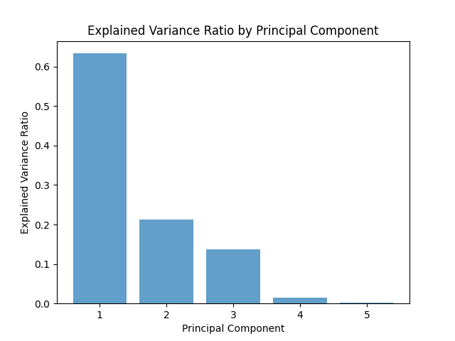
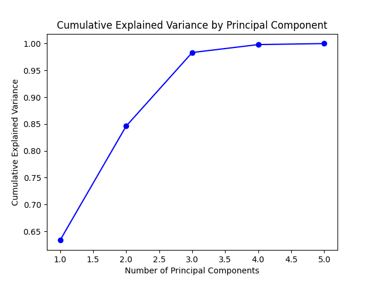

# Climate drivers in Armenia

Machine-learning study of **what drives climate variability and extremes over Armenia**, built on hourly
[ERA5](https://cds.climate.copernicus.eu/) reanalysis data from the Copernicus Climate Data Store.

The project was done in collaboration between **UFAR** (French University in Armenia) and **IIAP**
(Institute for Informatics and Automation Problems of the National Academy of Sciences of Armenia).
The long-term goal is to take a past extreme weather event in Armenia (for example a cyclone), study how the
climate variables behaved before it, and use statistical and ML methods to reproduce and explain it.

## What's inside

| Part | What it does |
|---|---|
| `data_hunter_era5.py` | **ERA5 downloader.** `DataRetriver` fetches any ERA5 single-level variables for a date range and a lat/lon box through `cdsapi`, one NetCDF file per day, with a local cache (`NetCDF_data/era5/…`) so nothing is downloaded twice. Returns file paths or `xarray` datasets. |
| `pca.py` · `PCA.ipynb` | **Principal component analysis** of the chosen variables (standardised): explained-variance ratio, cumulative variance and the loading of each variable on each component. Plots are saved to `pca_images/`. |
| `k-means.py` · `K-Means_wind.ipynb` | **K-means clustering** (k = 3) of hourly weather states, e.g. wind components and temperature, at one grid point; prints the cluster centroids and which cluster a new observation belongs to. |
| `multivariate_regression.py` · `Regression.ipynb` | **Multivariate OLS regression** (statsmodels) of one variable on the others; prints the model summary and the fitted formula. |
| `CNI.ipynb` | **Causal network inference** with a Bayesian network (pgmpy): wind (u10, v10) and surface pressure → 2 m temperature, with MAP queries and a graph of the network. |

All analyses currently look at **Yerevan** (40.18° N, 44.51° E) for the period **25–28 November 2019**, using
variables such as 2 m temperature, 10 m wind components, surface pressure and soil temperature.

### Example results (PCA)

 

## Getting started

1. **Install the dependencies** (Python 3.10+):
   ```bash
   pip install -r requirements.txt
   ```
   (or `python dependency_installer.py`). The regression and causal-network parts also need
   `pip install statsmodels networkx`. Install Jupyter to run the notebooks.

2. **Get a Copernicus CDS API key.** Create a free account at the Climate Data Store and put your key in `~/.cdsapirc`:
   ```
   url: https://cds.climate.copernicus.eu/api
   key: <your-key>
   ```
   See the [CDS API how-to](https://cds.climate.copernicus.eu/how-to-api).

3. **Download data from Python:**
   ```python
   from data_hunter_era5 import DataRetriver

   # area is [North, West, South, East]
   datasets = DataRetriver.retrive_data_xarray(
       "2019-11-25", "2019-11-28",
       ["2m_temperature", "10m_u_component_of_wind", "10m_v_component_of_wind"],
       [41, 43, 38.5, 46],
   )
   ```
   Or use `DataRetriver.retrive_custom_data(startDate, endDate, properties, long_min, long_max, lat_min, lat_max)`.

4. **Run an analysis from the command line** (variable lists are Python literals, coordinates are longitude then latitude):
   ```bash
   python pca.py "['2m_temperature','surface_pressure','10m_u_component_of_wind']" 44.51 40.18
   python k-means.py "['2m_temperature','10m_u_component_of_wind']" "[280.0, 1.5]" 44.51 40.18
   python multivariate_regression.py 2m_temperature "['surface_pressure','10m_u_component_of_wind']" 44.51 40.18
   ```

## Stack

Python · xarray · NetCDF4 · cdsapi · pandas · NumPy · scikit-learn · statsmodels · pgmpy · matplotlib · Jupyter

## Next steps

- Extend the analysis from a few days to multi-year periods and to the whole territory of Armenia.
- Pick specific past extreme events and compare the variables in the days before them with normal conditions.
- Make the analysis period and location configurable instead of fixed in the scripts.
